# Splitfy

Splitfy tracks shared costs in a group (trips, rent, dinners) and works out who
owes whom in as few payments as possible. It is one Kotlin Multiplatform
repository: the Android app, the iOS app and the API that serves them.

**Status: code-complete for a closed beta, with staging live.** The API runs at
[splitfy.onrender.com](https://splitfy.onrender.com) on Neon PostgreSQL
([API docs](https://splitfy.onrender.com/openapi)). Every screen talks to the real
API, and the full test suite is green. What stands between this and real users is
credentials, production capacity and store paperwork, not features. See
[Launch status](#launch-status).

## Screenshots

The UI is one Compose Multiplatform codebase, so Android and iOS render the same
screens. These are from the Android app against a local backend with sample data.

| Onboarding | Home | A group | Who owes whom |
|:-:|:-:|:-:|:-:|
| 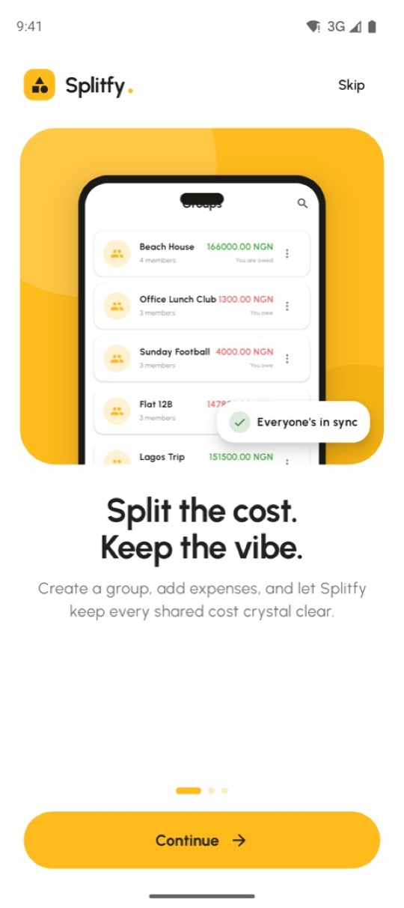 | 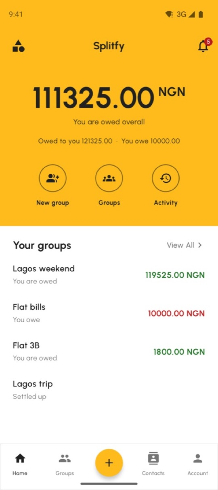 | 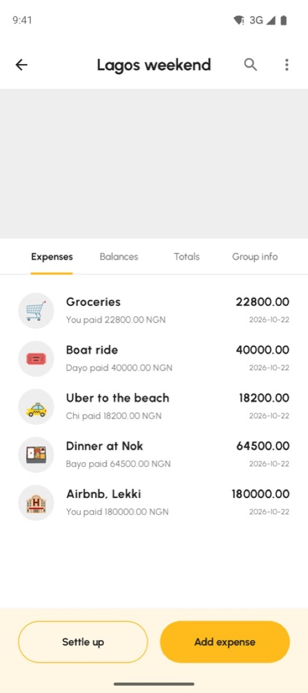 | 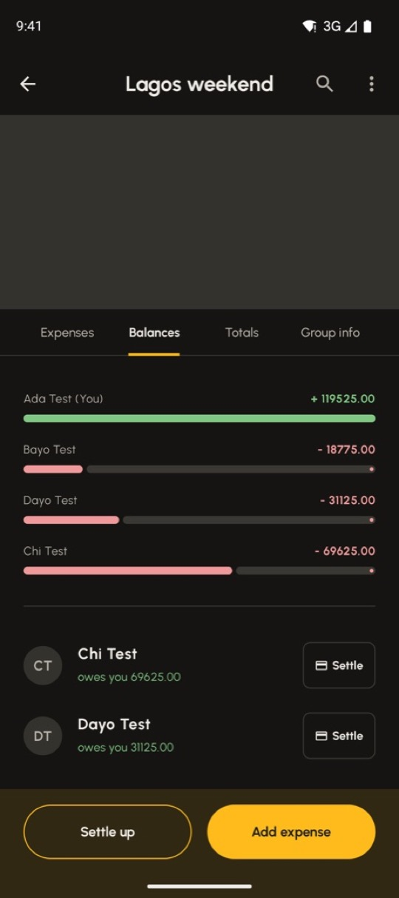 |

| Add an expense | Settle up | Activity | Security |
|:-:|:-:|:-:|:-:|
| 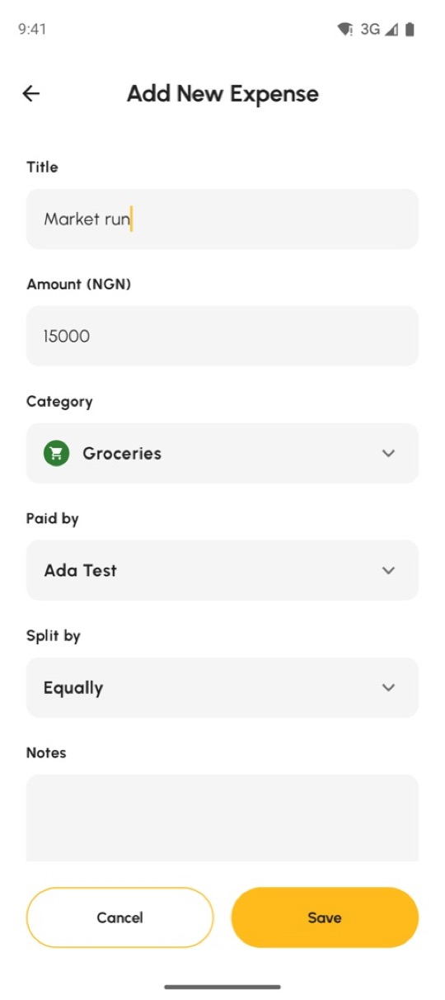 | 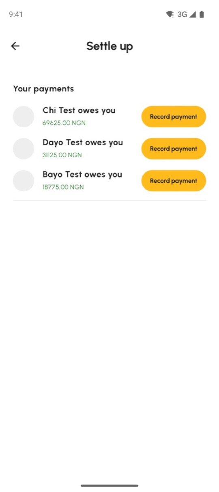 | 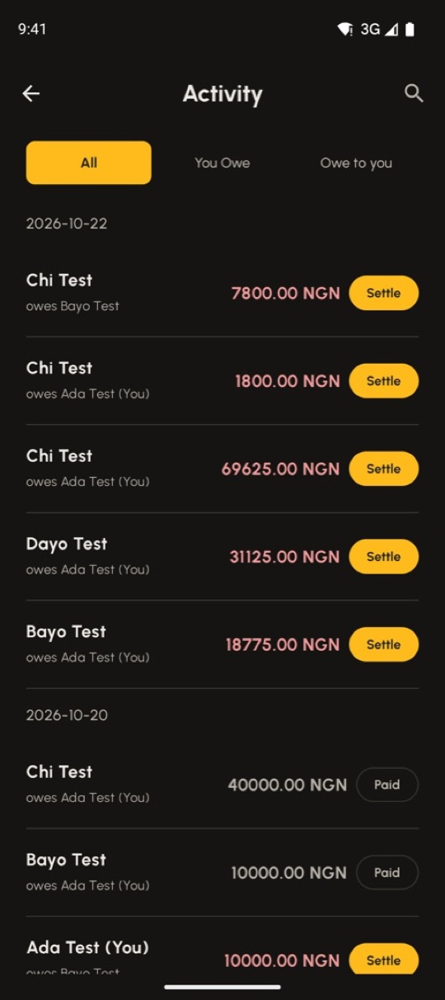 | 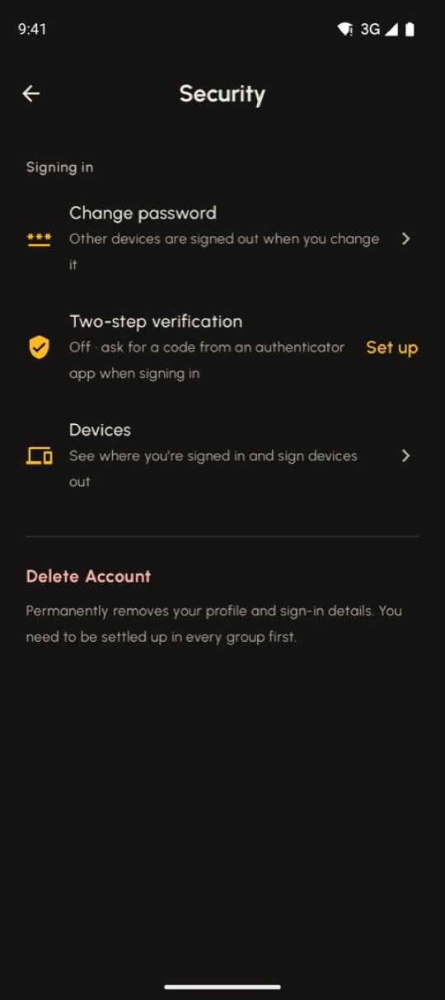 |

<details>
<summary>Dark mode, loading and launch</summary>

| Home (dark) | Account (dark) | Loading skeletons | Splash (light / dark) |
|:-:|:-:|:-:|:-:|
| 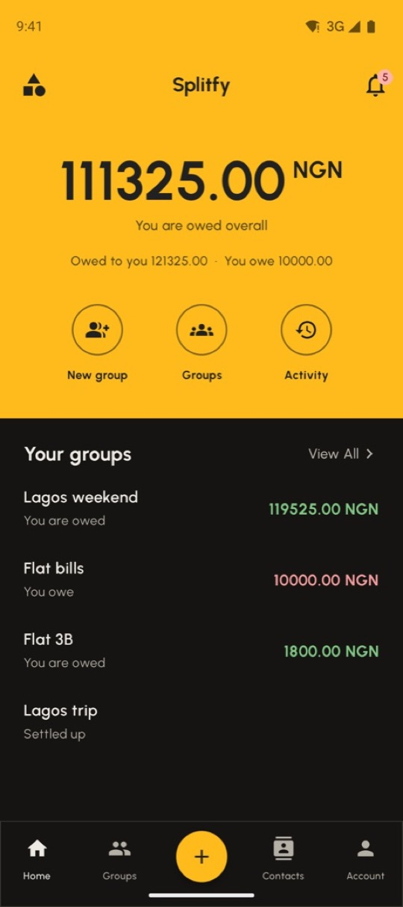 | 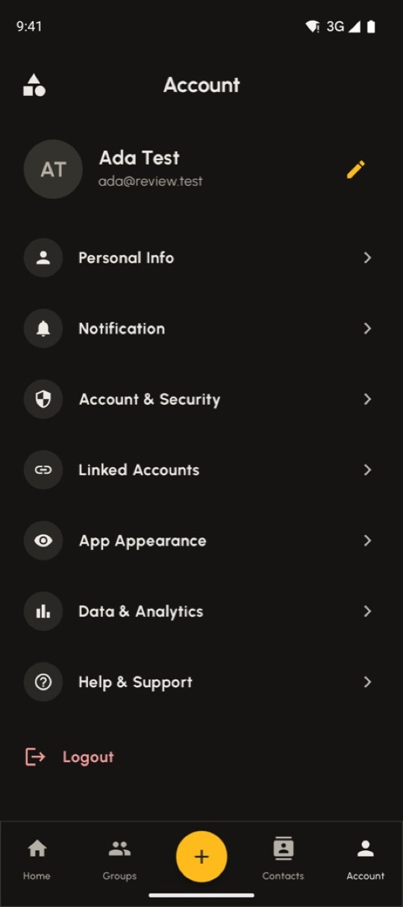 | 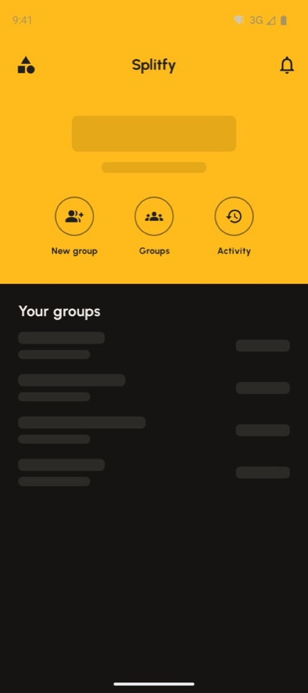 |   |

</details>

## What it does

- **Groups and expenses.** Split equally, by exact amounts, by percentage or by
  shares, with receipts attached. Balances reduce to a minimal set of transfers.
- **Settling up.** Settlements are recorded, not moved: you pay outside the app (cash,
  bank transfer), mark it paid, and the payee confirms. This is the Splitwise model,
  and it keeps Splitfy out of stored-value licensing.
- **Getting people in.** Invite links (`https://splitfy.app/i/{token}`) with Android
  App Links and iOS Universal Links, and adding members by email.
- **Staying informed.** An activity feed, in-app notifications, push through FCM and
  APNs, and opt-out reminders for balances left open.
- **Accounts.** Email and password with OTP verification, Google and Apple sign-in,
  profile photos, email change, linked accounts, password change, named device
  sessions, app lock (biometrics), authenticator-app 2FA with recovery codes, data
  export and account deletion.
- **The app.** Light and dark themes, skeleton loading and pull-to-refresh, with a
  status bar that adapts to what is drawn behind it.

The wallet (balances, top-up, withdrawal, payment methods, peer transfers and
scan-to-pay) exists in the code but is **switched off** on both sides until a
payment provider backs it. See [Feature flags](#feature-flags).

## Architecture

```
splitfy/
├── core/                KMP · API contract, domain model, split and settlement maths, validators
├── backend/             JVM · Ktor API, PostgreSQL (Exposed + Flyway)
├── app/
│   ├── shared/          KMP · Compose Multiplatform screens, view models, client data layer
│   ├── ui-components/   KMP · design system: theme, components, fonts
│   ├── androidApp/      Android host: manifest, icons, splash, one Activity
│   └── iosApp/          Xcode project hosting the shared Compose UI
├── scripts/brand/       Icon and launch-logo renderer
└── docs/                Architecture, deployment and feature notes
```

The layout follows JetBrains' [KotlinConf app](https://github.com/JetBrains/kotlinconf-app).
The decisions that matter:

- **`:core` is compiled by both client and server.** It holds the DTOs, route
  constants, error codes, the split and settlement maths, and the validators.
  A split previewed on a phone is byte-identical to the one the server stores, and
  a renamed endpoint fails the build instead of returning a 404 in production.
- **Money is integers, never floating point.** `Money(amount: Long, currency)` holds
  minor units (kobo, cents), and rounding is decided once, in `:core`, so nobody is
  left owing a stray kobo.
- **Writes are idempotent.** Expense and settlement creates carry a `clientRequestId`
  with a unique constraint, so a retry on a flaky network returns the original row
  instead of a duplicate.
- **PostgreSQL is the only system of record.** The schema changes only through
  append-only Flyway migrations (`backend/src/main/resources/db/migration`, V1–V11).
  Tests run against a real embedded PostgreSQL with those migrations applied, not H2.
- **Short-lived access, rotated refresh.** 15-minute JWT access tokens and 30-day
  refresh tokens that rotate on every use and are tied to a named device session.
  Replaying an already-rotated token is treated as theft and revokes the user's sessions.
  The client signs out only on a definitive 401; a 5xx during refresh leaves the
  session intact.
- **One UI codebase.** Screens, navigation and view models are shared Compose
  Multiplatform code. The platform layers only host it and provide the platform
  pieces: credentials, biometrics, push, the camera and the image picker.

[docs/ARCHITECTURE.md](docs/ARCHITECTURE.md) goes deeper on the layers and the
request lifecycle.

**Stack:** Kotlin 2.3 · Compose Multiplatform 1.10 · Ktor 3.5 (server and client) ·
Koin 4 · Exposed · Flyway · PostgreSQL 16 · Gradle 9.3 · Android API 24–36 · iOS 18.2+.

## Getting started

### Prerequisites

- **JDK 17** (Gradle 9.3 supports 17–25; `gradle/gradle-daemon-jvm.properties` pins 17)
- **Android SDK.** Set `ANDROID_HOME`, or `sdk.dir` in `local.properties`.
- **Xcode 16 or later** for iOS
- **Docker**, optional, for the one-command backend

### Run the backend

```bash
docker compose up --build
```

Postgres 16 and the API start together and the migrations run on boot. The API
serves on `http://localhost:8080`:

- interactive docs at `/openapi`
- liveness at `/health`, readiness at `/ready`

To run against a Postgres you already have:

```bash
./gradlew :backend:run
```

Locally, OTP codes are written to the server log instead of being emailed.

### Run the apps

```bash
./gradlew :app:androidApp:installDebug
```

The Android debug build talks to `http://10.0.2.2:8080`, which is the host machine as
seen from the emulator.

For iOS, open `app/iosApp/iosApp.xcodeproj` and run. A build phase calls Gradle to
produce the `shared` framework. The debug build talks to `http://localhost:8080`.

On a physical device, point the app at your machine's LAN address in the
gitignored local config (see [App configuration](#app-configuration)).

## Testing

```bash
./gradlew :core:allTests :backend:test :app:shared:iosSimulatorArm64Test
```

| Suite | What it covers |
|---|---|
| `:core` (JVM and iOS) | Split maths, rounding, and balance and settlement algebra |
| `:backend` | HTTP integration tests against embedded PostgreSQL with the real migrations. Also covers the auth flows, permissions, idempotency, invites, uploads, push and 2FA, and checks that every Exposed column matches the migrated schema. |
| `:app:shared` | View models and the data layer over a mocked transport, plus the session and token-refresh rules |

CI ([`.github/workflows/ci.yml`](.github/workflows/ci.yml)) runs three jobs on every
push and pull request:

- core and backend tests, plus the fat JAR, on Linux
- an Android debug build
- the shared tests on the iOS simulator, plus the framework link

## Configuration

### App configuration

Each platform reads its identity and API host from one committed file. Nothing is
hard-coded in Kotlin.

| Platform | File | Holds |
|---|---|---|
| Android | `app/androidApp/config.properties` | App name, application ID, version, API base URLs, Google web client ID, Sentry DSN |
| iOS | `app/iosApp/Configuration/{Config,Debug,Release}.xcconfig` | Bundle ID, version, API host, Google iOS client ID, Sentry DSN, `TEAM_ID` |

Personal overrides go in gitignored siblings that are read last:
`app/androidApp/config.local.properties` and `app/iosApp/Configuration/Local.xcconfig`.
Put your signing `TEAM_ID` or LAN address there.

### Backend configuration

Everything comes from the environment (see `backend/src/main/resources/application.yaml`).
In `PRODUCTION` the server **refuses to start** with:
- the development JWT secret or database password
- no `RESEND_API_KEY`
- no `TOTP_ENCRYPTION_KEY`

| Area | Variables |
|---|---|
| Runtime | `APP_ENV` (`LOCAL`/`STAGING`/`PRODUCTION`), `PORT`, `APP_VERSION`, `SHUTDOWN_GRACE_MS`, `SHUTDOWN_TIMEOUT_MS` |
| Database | `DATABASE_URL`, `DATABASE_USER`, `DATABASE_PASSWORD`, `DATABASE_POOL_SIZE`, `DATABASE_RUN_MIGRATIONS`, `DATABASE_STATEMENT_TIMEOUT_SECONDS` |
| Auth | `JWT_SECRET` (32+ chars), `JWT_ISSUER`, `JWT_AUDIENCE`, `JWT_ACCESS_MINUTES`, `JWT_REFRESH_DAYS`, `BCRYPT_COST`, `OTP_MINUTES`, `TOTP_ENCRYPTION_KEY` |
| Email | `RESEND_API_KEY`, `EMAIL_FROM` (on a domain verified in Resend) |
| Social sign-in | `GOOGLE_CLIENT_IDS`, `APPLE_CLIENT_IDS` (comma-separated; empty turns the provider off) |
| Invite links | `PUBLIC_BASE_URL`, `ANDROID_PACKAGE`, `ANDROID_CERT_SHA256`, `APPLE_APP_IDS` |
| Uploads | `STORAGE_ENDPOINT`, `STORAGE_BUCKET`, `STORAGE_ACCESS_KEY`, `STORAGE_SECRET_KEY`, `STORAGE_REGION`, `STORAGE_PUBLIC_BASE_URL` (any S3-compatible store, such as R2 or S3) |
| Push | `FCM_SERVICE_ACCOUNT_JSON` or `FCM_SERVICE_ACCOUNT_PATH`, `PAYMENT_REMINDERS_ENABLED`, `PAYMENT_REMINDER_AFTER_DAYS`, `PAYMENT_REMINDER_EVERY_DAYS`, `PAYMENT_REMINDER_HOUR_UTC` |
| Observability | `SENTRY_DSN`, `METRICS_TOKEN` (guards `/metrics`) |
| Features | `FEATURE_WALLET` |

### Feature flags

A feature that is off must be off on **both** sides. The client constant hides the
screens, and the server flag removes the routes, so they can't be called directly.

| Feature | Client | Server | State |
|---|---|---|---|
| Wallet and payments | `FeatureFlags.WALLET` in `:app:shared` | `FEATURE_WALLET` | Off: a top-up currently credits without charging |

## Environments

| | Staging | Production |
|---|---|---|
| API | [`https://splitfy.onrender.com`](https://splitfy.onrender.com) | `https://api.splitfy.app` (not yet live) |
| API docs | [`/openapi`](https://splitfy.onrender.com/openapi) | |
| Health | [`/health`](https://splitfy.onrender.com/health) (process up), [`/ready`](https://splitfy.onrender.com/ready) (database reachable) | |
| Hosting | Render web service, Docker, Frankfurt, free instance | |
| Database | Neon PostgreSQL 16, AWS Frankfurt (`eu-central-1`), free plan | |
| Email | Resend, sending from `splitfy.app` | |

The release app build already points at `https://api.splitfy.app`. That host is
staging until production exists: add it as a custom domain on the Render service,
then create the CNAME Render shows in the `splitfy.app` DNS (managed in Vercel).

**Free-tier limits, accepted for staging only:**
- The Render free instance sleeps after about 15 minutes idle, and the first
  request after that takes up to a minute while the JVM starts on 0.1 CPU.
- Neon's free compute scales to zero, so the first query after a quiet spell is
  slower.
- Neither plan gives meaningful backups. Upgrade both before any real user's data
  lives there.

### Deploying the backend to Render

The service builds the backend's Docker image from the **repository root**, because
`:backend` depends on `:core` and the root Gradle build. Pointing Render at
`backend/` alone fails the build.

| Render setting | Value |
|---|---|
| Language | Docker |
| Root Directory | *empty* (repository root) |
| Dockerfile Path | `backend/Dockerfile` |
| Docker Build Context | `.` |
| Region | Frankfurt, next to the database |
| Health Check Path | `/ready` |
| Branch | `main` |

`PORT` is injected by Render and read by the server; don't set it. Migrations run on
boot. Flyway takes a lock, so this is safe for one instance. With several instances,
switch to the pre-deploy migrator described in
[docs/DEPLOYMENT.md](docs/DEPLOYMENT.md#running-migrations).

**Database (Neon).** Use the **direct** connection string, with *Connection pooling*
off in Neon's Connect dialog: Flyway's migration lock needs a session, which the
pooler doesn't provide. The server takes the connection as three variables in JDBC
form, not Neon's `postgresql://` URL. Neon's `channel_binding` parameter is dropped;
`sslmode=require` keeps the connection encrypted.

```properties
DATABASE_URL=jdbc:postgresql://<endpoint>.eu-central-1.aws.neon.tech:5432/<database>?sslmode=require
DATABASE_USER=<role>
DATABASE_PASSWORD=<password>
```

**Environment.** Secrets live only in Render's environment settings, never in the
repository or the image. To prepare them locally, write a `.env.render` file (any
`.env.*` file is gitignored) and paste it into Render's *Add from .env* dialog.

| Variable | Staging value |
|---|---|
| `APP_ENV` | `STAGING` (the image defaults to `PRODUCTION`) |
| `DATABASE_URL`, `DATABASE_USER`, `DATABASE_PASSWORD` | From Neon, as above |
| `JWT_SECRET` | `openssl rand -base64 48`. Rotating it signs everyone out. |
| `TOTP_ENCRYPTION_KEY` | `openssl rand -base64 32`. **Never change it once anyone has enabled 2FA**: it encrypts their authenticator secrets. |
| `RESEND_API_KEY` | A **send-only** Resend key |
| `EMAIL_FROM` | `"Splitfy <no-reply@splitfy.app>"` |
| `JWT_ISSUER`, `JWT_AUDIENCE` | `https://api.splitfy.app`, `splitfy-mobile` |
| `PUBLIC_BASE_URL` | `https://splitfy.app` |

Not set yet, so those features are off: `GOOGLE_CLIENT_IDS`, `APPLE_CLIENT_IDS`
(social sign-in), `FCM_SERVICE_ACCOUNT_JSON` (push), `STORAGE_*` (receipt and cover
uploads), `SENTRY_DSN` (error reporting), `ANDROID_CERT_SHA256` and `APPLE_APP_IDS`
(invite links opening the app). The server starts without them.

**Verifying a deploy.** The deploy log shows Flyway either applying migrations
(`Successfully applied N migrations` on the first deploy or after a schema change)
or reporting the schema up to date, then `Responding at …`. After that, check:

```bash
curl -s https://splitfy.onrender.com/ready
```

It should report `"status": "UP"` with `"database": "UP"`. A bad login should
return `401 INVALID_CREDENTIALS`, which proves routing, the database and error
handling end to end.

**Pointing a debug build at staging.** Override the API host in the gitignored
local config:

```properties
# app/androidApp/config.local.properties
api.baseUrl.debug=https://splitfy.onrender.com
```

On iOS, set `API_SCHEME = https` and `API_HOST = splitfy.onrender.com` in
`app/iosApp/Configuration/Local.xcconfig`. Sign up with an inbox you own: staging
sends real email, and bounced test addresses hurt the sending domain's reputation.

## Releasing

| Artifact | How |
|---|---|
| Backend | Pushing a `v*` tag builds the image and pushes it to GHCR ([`release-backend.yml`](.github/workflows/release-backend.yml)). Migrations run through a standalone migrator before rollout. |
| Android | A `v*` tag builds a signed AAB from CI secrets ([`release-android.yml`](.github/workflows/release-android.yml)). Uploading to Play is still manual. |
| iOS | Manual for now: archive in Xcode with a team set. |

[docs/DEPLOYMENT.md](docs/DEPLOYMENT.md) covers hosting options, secrets, migrations,
health checks and rollback.

## Launch status

Done:
- the core loop, settle-up, invites, receipts and push
- the full account section (security, 2FA, privacy)
- dark mode, icons and splash
- crash reporting wired on all three tiers
- account deletion, as both stores require

Remaining before a public release, roughly in order:

1. **Production capacity.** Staging runs on Render and Neon free tiers (see
   [Environments](#environments)). Before real users:
   - move both to paid plans: an always-on instance, and backups with
     point-in-time recovery
   - point `api.splitfy.app` at the service
   - rotate `JWT_SECRET`, `TOTP_ENCRYPTION_KEY` and the database password, which
     were shared during setup
2. **Credentials.** Resend is configured. Still to supply:
   - Google and Apple client IDs
   - FCM and the APNs key
   - S3 or R2 storage
   - Sentry DSNs
   - the invite-link signing fingerprint and Apple app IDs
   - the iOS `TEAM_ID`
3. **iOS compliance.** Add a privacy manifest (`PrivacyInfo.xcprivacy`), set up
   signing and TestFlight, and add the Sentry Swift package. Sign in with Apple needs
   the capability on a signed build.
4. **Legal.** Terms and Privacy are drafts and show an in-app "pending legal
   review" banner. Remove it with `LEGAL_REVIEW_PENDING` in `LegalCopy.kt`.
5. **CI.** GitHub Actions jobs are currently blocked by an account billing issue.

Planned after launch: multi-currency expenses, offline-first sync (SQLDelight with an
outbox), translations (the language picker is hidden until they exist), and real
payments, which need legal review first. The phase-by-phase plan is in
[docs/IMPLEMENTATION_PLAN.md](docs/IMPLEMENTATION_PLAN.md).

## Conventions

- **Migrations are append-only.** Never edit one that has been deployed; add the
  next `V<n>__…sql` instead.
- **No hard-coded colours in screens.** Use `MaterialTheme.colorScheme` or
  `AppTheme.colors`; [docs/THEMING.md](docs/THEMING.md) has the mapping. A screen
  that draws under the status bar marks it with `Modifier.statusBarBackground`.
- **Users never see raw errors.** Map failures to plain messages, and send platform
  error text and exceptions to the log.
- **Brand assets are generated.** Edit `scripts/brand/render_icons.swift` and re-run
  it (`swift scripts/brand/render_icons.swift`) instead of hand-editing the PNGs.
- **The product name is "Splitfy"** in anything a user reads. Identifiers, hosts and
  the `splitfy://` scheme stay lowercase.

## Documentation

| Doc | For |
|---|---|
| [ARCHITECTURE.md](docs/ARCHITECTURE.md) | Module boundaries, data flow, and what was deliberately left out |
| [DEPLOYMENT.md](docs/DEPLOYMENT.md) | Hosting, secrets, migrations, monitoring |
| [SERVER_README.md](docs/SERVER_README.md) / [MOBILE_README.md](docs/MOBILE_README.md) | Per-tier development notes |
| [GROUP_INVITES.md](docs/GROUP_INVITES.md) | Invite links, App Links and Universal Links setup |
| [PUSH_NOTIFICATIONS.md](docs/PUSH_NOTIFICATIONS.md) | Firebase and APNs setup |
| [THEMING.md](docs/THEMING.md) | Light and dark theme rules |
| [IMPLEMENTATION_PLAN.md](docs/IMPLEMENTATION_PLAN.md) | The phased plan to launch |
| [split_bill_app_prd.md](docs/split_bill_app_prd.md) | The original product brief |
